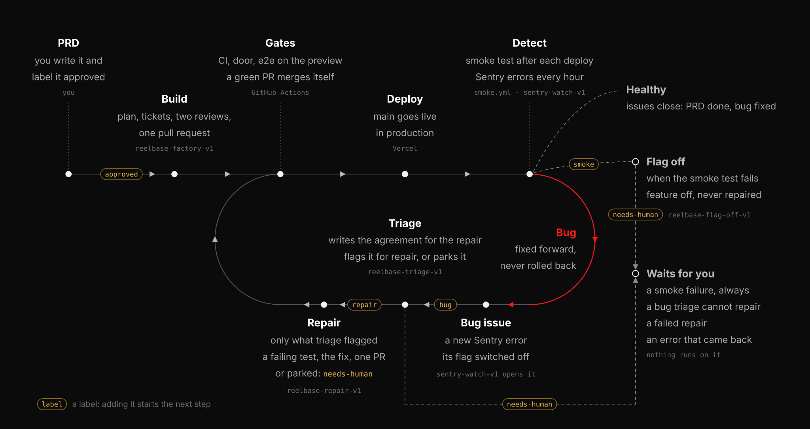

# Lifecycle

How a change reaches production and how a production failure is handled: who starts whom, and
which label does it. The tasks themselves, with their prompts, are in
[cloud-tasks.md](cloud-tasks.md).

Nothing starts another thing directly. An actor adds a label or opens an issue, and that event
starts the next actor.

## The flow

A yellow pill is a label. Adding it starts the step the arrow points to.

## Who triggers whom

| Actor | Started by | Event | What it leaves behind | Which starts |
|---|---|---|---|---|
| You | | | `approved` on a `prd` issue | `reelbase-factory-v1` |
| `reelbase-factory-v1` | You | A `prd` issue gets `approved` | A pull request | GitHub auto-merge |
| GitHub auto-merge | A pull request from a `claude/` branch | Every required check is green | A merge to `main` | Vercel deploy |
| Vercel deploy | The merge | Push to `main` | A production deployment | `smoke.yml` |
| `smoke.yml` | Vercel | Deployment succeeded | On a 200: the pull request's issues closed. Otherwise: an issue labeled `smoke` | `reelbase-flag-off-v1`, only on a failure |
| `reelbase-flag-off-v1` | `smoke.yml` | An issue gets `smoke` | The flag off, a `Flag off:` comment, `needs-human` | Nothing. You |
| `reelbase-sentry-watch-v1` | The clock | Every hour | For a new Sentry error: its flag off, an issue labeled `bug` | `reelbase-triage-v1` |
| `reelbase-triage-v1` | The Sentry watch | An issue gets `bug` | A `Triage:` comment, and `repair` or `needs-human` | `reelbase-repair-v1`, only with `repair` |
| `reelbase-repair-v1` | Triage, or you | A `bug` issue gets `repair` | A `Repair: started` comment and a pull request that says `Repairs #N` | GitHub auto-merge |
| The sweep, part of `reelbase-sentry-watch-v1` | The clock | Every hour | For a repaired bug: the flag back on, then the bug closed. For an error that came back: `needs-human` | Nothing |

## Labels

| Label | Put on | Added by | Starts | Means |
|---|---|---|---|---|
| `prd` | An issue | You, through `/as-spec` | | A spec |
| `approved` | A `prd` issue | You | `reelbase-factory-v1` | Build it |
| `smoke` | An issue | `smoke.yml` | `reelbase-flag-off-v1` | The home page did not answer 200 after a deploy |
| `bug` | An issue | `reelbase-sentry-watch-v1` | `reelbase-triage-v1` | A new production error in Sentry |
| `repair` | A `bug` issue | `reelbase-triage-v1`, or you | `reelbase-repair-v1` | Approved for one repair |
| `needs-human` | A `smoke` or `bug` issue | Flag-off, triage, repair, the sweep | Nothing | Waits for you. No task takes it |

A comment that starts with a fixed word marks an issue as handled, so a second run leaves it alone:

| Comment starts with | Written by | Means |
|---|---|---|
| `Flag off:` | `reelbase-flag-off-v1` | The smoke issue was handled |
| `Triage:` | `reelbase-triage-v1` | The bug was triaged. With `repair`, it holds the agreement |
| `Repair: started` | `reelbase-repair-v1` | A repair run has claimed the bug |
| `Flag on:` | The sweep | The fix is live and the feature is back on |

## The paths, one by one

**A change**

1. You add `approved` to a `prd` issue.
2. `reelbase-factory-v1` builds it and opens a pull request.
3. GitHub merges it when the checks are green. Vercel deploys.
4. `smoke.yml` gets a 200 and closes the pull request's issues.

**A smoke failure**

1. `smoke.yml` does not get a 200. It opens an issue labeled `smoke`.
2. `reelbase-flag-off-v1` turns off the flag of the deployed pull request and adds `needs-human`.
3. It ends there. No triage and no repair: when a deploy broke the home page, you look.
4. While that issue is open, every new `bug` gets `needs-human` too.

**A Sentry error**

1. `reelbase-sentry-watch-v1` finds a new error. It leaves out an error whose Sentry ID is already
   in an issue. It turns off the flag of the pull request that caused it and opens an issue
   labeled `bug`.
2. `reelbase-triage-v1` reads the bug. It adds `needs-human`, or it writes the agreement in a
   `Triage:` comment and adds `repair`.
3. `reelbase-repair-v1` builds the fix from that agreement and opens a pull request.
4. GitHub merges it. Vercel deploys. `smoke.yml` tests that deploy like any other.
5. The sweep turns the flag back on. An hour later, when the error has not come back, it closes
   the bug.

**Where it stops and waits for you**

| The issue gets `needs-human` when | Added by |
|---|---|
| The smoke test failed | `reelbase-flag-off-v1` |
| A `smoke` issue is open | `reelbase-triage-v1` |
| An older open `bug` names the same pull request | `reelbase-triage-v1` |
| The bug names no merged pull request, the pull request is itself a repair, or the cause is not one testable line | `reelbase-triage-v1` |
| The repair could not be built or did not pass its review | `reelbase-repair-v1` |
| The error came back after the fix, or the home page failed with the flag back on | The sweep |

To send a waiting bug to repair, remove `needs-human` and add `repair`. Triage does not run again.

## Why it cannot loop

- A smoke failure is never repaired.
- Only triage adds `repair`, and only to a bug with no `Triage:` comment yet.
- A bug whose failing pull request is itself a repair is not repaired again.
- A repair that fails, or an error that comes back, ends at `needs-human`.
- A repair's own deploy that fails the smoke test opens a `smoke` issue, which ends at you.
